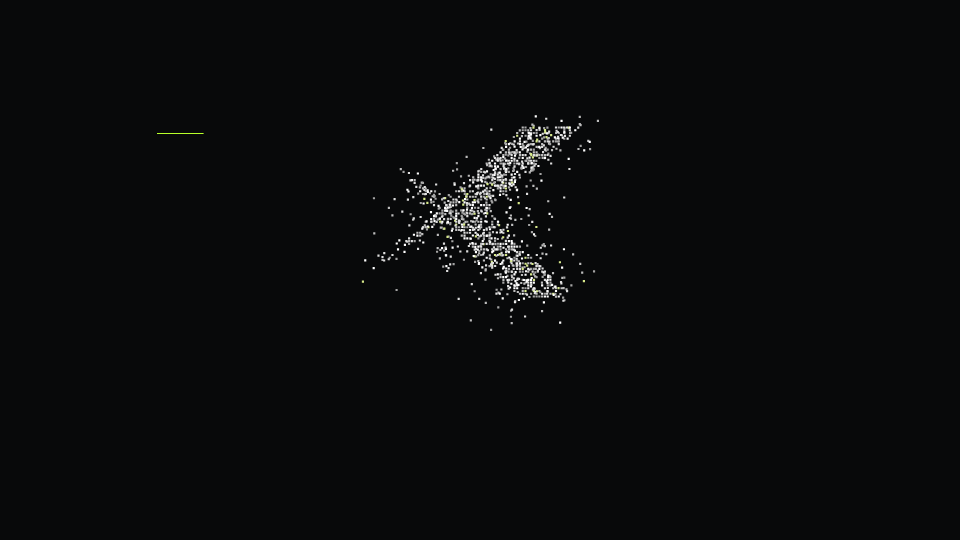

# Xperiencia Creativa · Video de presentación

Proyecto **Remotion + React + TypeScript** independiente de la página web.
Video corporativo de **55 segundos, 30 fps, 16:9**, con composiciones UHD y Full HD,
H.264, Rec.709 y loop continuo. Funciona sin audio.



## Videos finales

La revisión aprobada está incluida en el repositorio:

- [MP4 4K · 3840 × 2160](deliverables/andesmin-xperiencia-creativa-4k.mp4)
- [MP4 Full HD · 1920 × 1080](deliverables/andesmin-xperiencia-creativa-1080p.mp4)
- [MP4 de prueba · 960 × 540](deliverables/andesmin-xperiencia-creativa-prueba.mp4)

Esta versión incluye la X construida con píxeles a partir del trazado oficial.
Se retiró el crédito antiguo de Futura Studio de los clips utilizados, «REAL»
del titular, la fecha de feria del pie, «CONVERSEMOS» y la cuadrícula del inicio
y cierre. Los originales de los clips se conservan para regenerar sus derivados.

## Ejecutar

Usa Node.js 24 y npm. No requiere la web, Next.js, credenciales ni servicios externos.

```sh
git clone https://github.com/Experiencia-Creativa-SAC/Video-Presentacion.git
cd Video-Presentacion
npm ci
npm run video:studio
```

Abre [Remotion Studio](http://localhost:3005). Composiciones:
`Andesmin4K` y `Andesmin1080p`. El primer render descarga Chrome Headless Shell
oficial cuando no está instalado.

```sh
npm run video:test
npm run video:1080p
npm run video:4k
```

Los nuevos renders se guardan en `out/andesmin/`, excluido de Git. Los archivos
de `deliverables/` son la entrega aprobada; reemplázalos cuando apruebes una
nueva revisión. Los finales usan captura PNG, CRF 17 y códec H.264 con YUV 4:2:0.

## Modificar

| Qué cambiar | Archivo |
| --- | --- |
| Duración de escenas, colores, FPS, textos principales y tiempos internos | `video/videoConfig.ts` |
| Selección de clips, posters y punto de entrada en segundos | `video/assets.ts` |
| Textos con saltos específicos, encuadres y composición | `video/scenes/` |
| Construcción de la X, semilla y densidad de píxeles | `video/components/PixelX.tsx` y `PIXELS` en `videoConfig.ts` |
| Trazado oficial del logo | `src/components/ui/Wordmark.tsx` |

Las coordenadas de diseño usan 1920 × 1080; el texto y los SVG se rasterizan a
la resolución final. Los textos principales respetan 104 px de margen lateral
en Full HD y 208 px en UHD. Poppins está incluida en WOFF2 con su licencia OFL.

`QR.src` permanece en `null`. Puede recibir una imagen QR real verificada para
`https://xperienciacreativa.com/info`; existe espacio reservado a la derecha del
cierre. `OPTIONAL_AUDIO.src` acepta una pista local con derechos de uso y por
defecto permanece vacío. Las composiciones admiten `reducedMotion: true`.

## Assets y comprobaciones

`public/proyectos/` contiene el material original necesario y
`public/andesmin/video/` las copias preparadas sin el crédito antiguo. Los filtros
exactos están en `provenance.json` y `scripts/andesmin-clean-media.mjs`.
El metraje disponible es principalmente 720p; la salida UHD no añade detalle
nativo a esas grabaciones. El logo, la tipografía y los píxeles sí se renderizan
directamente en UHD. No se han incluido archivos de la aplicación web ni secretos.

```sh
npm run check
npm run video:stills
```

Con `ffmpeg` y `ffprobe` disponibles en PATH también puedes ejecutar:

```sh
npm run video:audit
npm run video:clean
node scripts/andesmin-qa.mjs --final
```

La última orden comprueba los renders de `out/andesmin/` después de generar
las tres resoluciones y los fotogramas de revisión. [Reporte de la entrega](docs/validation.json)
y [storyboard](docs/storyboard.jpg). La auditoría inicial de la marca y sus
materiales está documentada en `video/ASSET-AUDIT.md`.
